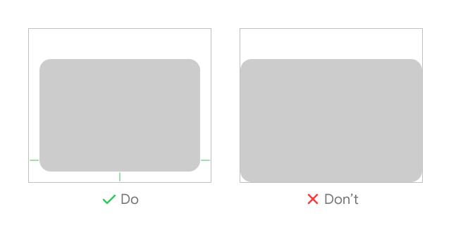
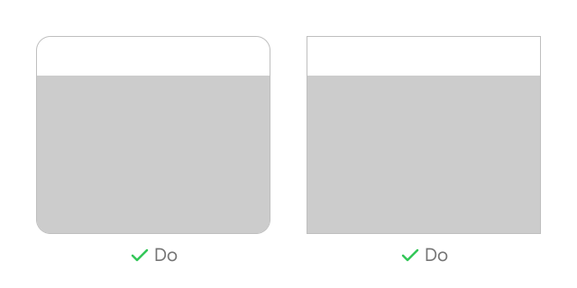
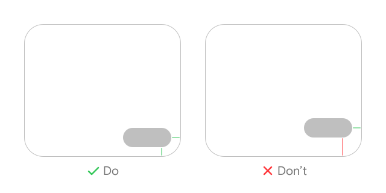
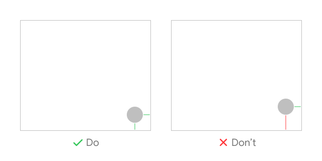
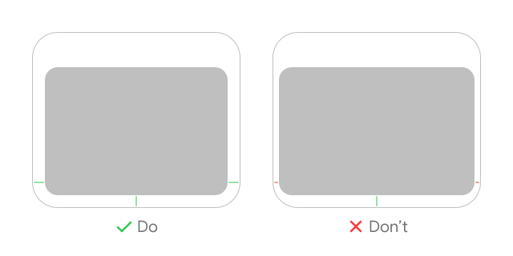
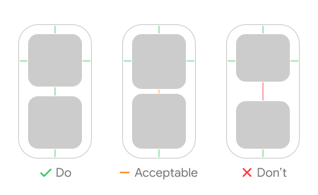
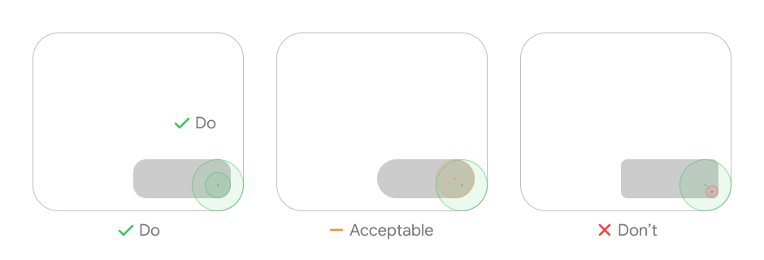

# UI Design Rules

Simple UI design rules that almost always apply, unless you’re building [art](https://en.wikipedia.org/wiki/Casa_Mil%C3%A0).

## Element should have spacing from its container

Spacing is not required for sections that extend to the container edges and follow its contour:

## Element should have equal x and y spacing from its container edges

This applies regardless of element or container shape:

The same principle applies when an element is inset from multiple edges:

## Spacing between items should match their spacing from the container

By default, items in a group should have the same spacing between each other as they have from the container edges.

Smaller gaps are acceptable when items are functionally related or need to read as a distinct group. This follows the proximity principle in [Gestalt psychology](https://en.wikipedia.org/wiki/Gestalt_psychology): items placed closer together are perceived as belonging together. Otherwise, keep the gaps equal to the container padding.

Gaps within the same group should never be larger than the spacing from the container edges.

## Element should be concentric to its container

The ideal element radius can be calculated as `elementRadius = containerRadius - inset`. For example, if `containerRadius = 32px` and `inset = 16px`, the ideal `elementRadius` is `16px`.

When choices are limited, an `elementRadius` that is slightly larger than the ideal radius is acceptable. Never use a radius smaller than the ideal value.
